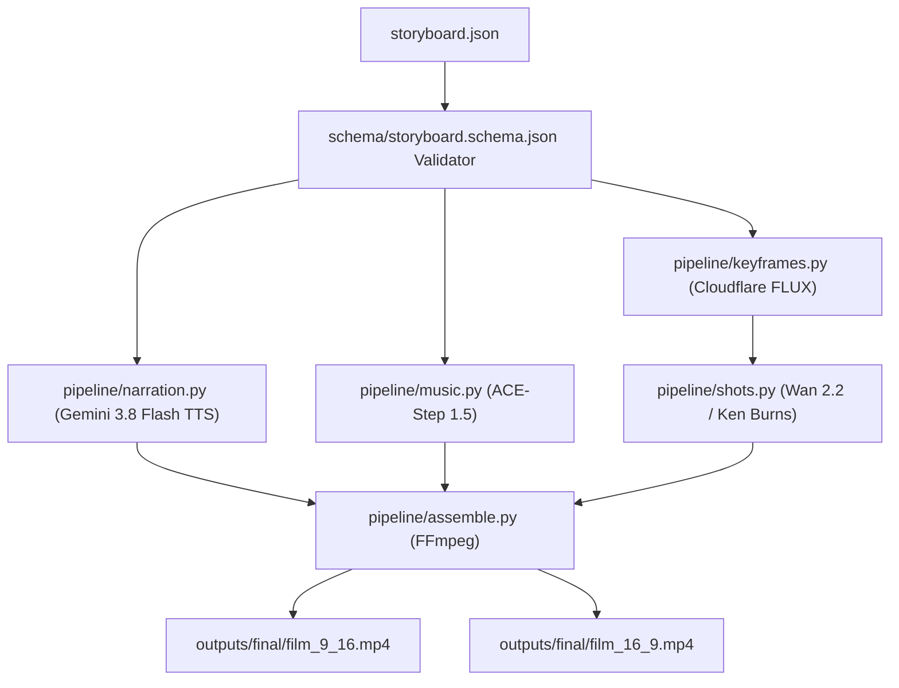

# Pipeline Architecture & Stage Contracts

## System Overview
The Heritage Short generation pipeline is an automated, contract-driven, reproducible multi-model pipeline that transforms a validated declarative contract (`storyboard.json`) into high-quality vertical (`9:16`) and horizontal (`16:9`) short films.

## Stage Contracts

### 1. Contract Validation
- **Input:** `storyboard.json`
- **Enforcement:** Validated against `schema/storyboard.schema.json` before any worker execution.
- **Fail-Fast:** Execution halts immediately with detailed schema errors if invalid.

### 2. Narration Stage (`pipeline/narration.py`)
- **Engine:** Google AI Studio `Gemini 3.8 Flash TTS`
- **Granularity:** Line-by-line (one `.wav` file per shot).
- **Output:** `outputs/audio/narration_{shot_id}.wav`
- **Duration Locking:** The exact measured speech duration drives the visual clip duration during assembly.

### 3. Keyframe Generation (`pipeline/keyframes.py`)
- **Engine:** Cloudflare Workers AI (`FLUX.2 klein` 4B / `FLUX.1 schnell`)
- **Consistency Enforcement:**
  - Conditioning on a Golden Reference Sheet.
  - Verbatim appending of a centralized `style_block`.
- **SHA-256 Input-Hash Caching:**
  - `cache_key = sha256(prompt + style_block + seed + model_params + ref_hash)`
  - If output exists and hash matches, generation is skipped.

### 4. Moving Shots (`pipeline/shots.py`)
- **Engine:** `Wan 2.2 TI2V-5B` (or `HunyuanVideo 1.5`) via batch GPU inference on Kaggle / Colab.
- **Fallback:** Automatic fallback to FFmpeg Ken Burns dynamic `zoompan` after 3 failed attempts or GPU exhaustion.

### 5. Original Score (`pipeline/music.py`)
- **Engine:** `ACE-Step 1.5`
- **Output:** 3 candidate stems in `outputs/audio/music_candidate_{1,2,3}.wav`.

### 6. Assembly & Mastering (`pipeline/assemble.py`)
- **Tool:** `FFmpeg`
- **Audio Ducking:** `sidechaincompress` dynamic ducking (threshold=0.02, ratio=6, attack=300ms, release=1500ms).
- **Subtitles:** Centered inside the 9:16 safe area (max 2 lines, ~40 characters per line).
- **Loudness Normalization:** Two-pass EBU R128 (`loudnorm`) targeting **-14 LUFS** and **true peak <= -1 dB**.
- **End Card:** 2–3s AI attribution card appended at the conclusion.
