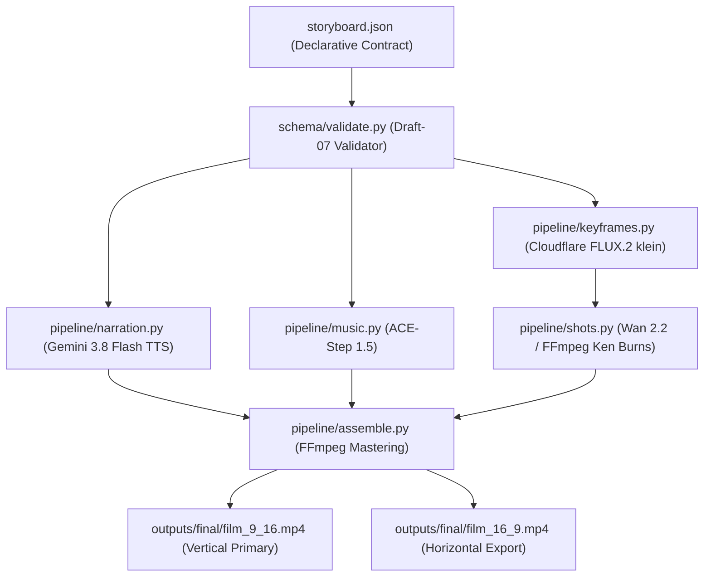

# The Heritage Short — AI-Content Generation Pipeline

[](./CHANGELOG.md)
[](./LICENSE)
[](./schema/storyboard.schema.json)
[]()

An automated, schema-driven, multi-model pipeline that transforms a single declarative contract (`storyboard.json`) into high-quality vertical (`9:16`) and horizontal (`16:9`) short films with synchronized speech, an original score, sidechain audio ducking, and burned-in subtitles.

---

## 📖 Story: *The Weight of the Handle (የእጁ ሚስጥር)*

> **"የማያውቁት ነገር ላብ ያበረክታል"**  
> *"What one does not know brings much sweat and toil."* — Traditional Ethiopian Proverb

Under the scorching sun of the Ethiopian highlands, a young apprentice named **Kaleb** exhausts himself trying to break stony soil through brute physical strength. Sinking to his knees in frustration, his grandfather, **Ato Berhanu**, steps forward. With weathered hands and calm poise, the elder adjusts Kaleb's grip, demonstrating that the secret lies in balance, leverage, and momentum—not reckless force.

* **Length:** ~64.5 seconds (9 structured narrative shots)
* **Language:** Native Amharic narration with English burned-in subtitles
* **Characters:** Fictional cultural archetypes (zero real-person likeness infringement; see [ETHICS.md](./ETHICS.md))

---

## 🏗️ Architecture & Pipeline Flow

The entire production is driven by **`storyboard.json`** as the single source of truth. Every stage is modular, testable, and equipped with **SHA-256 input-hash caching** so re-runs only regenerate changed shots.



---

## 🚀 Quickstart

### Prerequisites
* **Python 3.10+** (or [`uv`](https://docs.astral.sh/uv/))
* **FFmpeg** installed and accessible on your system `PATH`
* **Google AI Studio API Key** (Free tier for Gemini 3.8 Flash TTS)
* **Cloudflare Workers AI Account** (Free tier for FLUX keyframes)

### 1. Clone & Setup
```bash
# Clone the repository
git clone <your-repo-url>
cd the-heritage-short

# Create your local environment file
cp .env.example .env
```
Open `.env` in your editor and add your API credentials:
```env
GEMINI_API_KEY=your_gemini_api_key_here
CLOUDFLARE_ACCOUNT_ID=your_account_id_here
CLOUDFLARE_API_TOKEN=your_token_here
```

### 2. Install Dependencies
```bash
# Using standard pip
pip install -r requirements.txt

# Or using uv (recommended)
uv pip install -r requirements.txt
```

### 3. Validate the Storyboard Contract
Ensure `storyboard.json` strictly adheres to the schema constraints:
```bash
python schema/validate.py storyboard.json schema/storyboard.schema.json
```

---

## 🎬 Running the Pipeline

### Checkpoint 1: Narration & Radio Cut
Generate the line-by-line Amharic narration audio stems and assemble the pacing verification cut:
```bash
# Step 1: Generate speech per shot (with SHA-256 caching)
python pipeline/narration.py

# Step 2: Assemble the Radio Cut (subtitled audio over black screen)
python pipeline/assemble.py --radio-cut
```
*Output generated at:* `outputs/final/radio_cut.mp4`

---

## 🛠️ Key Engineering Features

1. **Deterministic Input-Hash Caching:**  
   Every keyframe and voice stem calculates `sha256(content + parameters)`. Modifying a single line in `storyboard.json` triggers regeneration **only** for that specific shot, leaving the rest cached.
2. **Automated Audio Mastering:**  
   Programmatic FFmpeg sidechain compression (`sidechaincompress`) automatically ducks background music beneath the dialogue stem, followed by two-pass EBU R128 (`loudnorm`) targeting **`-14 LUFS`** and true peak $\le -1\text{ dB}$.
3. **Safe-Area Subtitling:**  
   English subtitles are generated directly from the storyboard contract and burned inside the vertical `9:16` safe zone (clear of platform buttons on TikTok, Reels, and YouTube Shorts).
4. **Ken Burns Dynamic Fallback:**  
   If remote GPU video generation hits queue limits or exceeds 3 retries, the pipeline automatically falls back to smooth FFmpeg `zoompan` motion to guarantee deadline delivery.

---

## 📁 Repository Guide & Documentation Index

| File / Directory | Purpose |
| :--- | :--- |
| **[`storyboard.json`](./storyboard.json)** | Single source of truth: shot reasons, durations, prompts, narration, and seeds. |
| **[`schema/`](./schema/)** | JSON Schema validation engine enforcing contract rules before runs. |
| **[`pipeline/`](./pipeline/)** | Modular, decoupled generators for speech, images, video, score, and assembly. |
| **[`runs.jsonl`](./runs.jsonl)** | Append-only execution telemetry (latencies, parameters, timestamps, status). |
| **[`DESIGN.md`](./DESIGN.md)** | Target audience persona, viewing context, and User Tests #1 & #2 logs. |
| **[`ARCHITECTURE.md`](./ARCHITECTURE.md)** | Stage contracts, caching design, and error recovery workflows. |
| **[`ETHICS.md`](./ETHICS.md)** | Mandatory consent verification, model licenses, and AI attribution plan. |
| **[`EXPERIMENTS.md`](./EXPERIMENTS.md)** | 10+ hypothesis-driven tests (`Hypothesis -> Change -> Result`). |
| **[`FAILURES.md`](./FAILURES.md)** | Blocker journal, root cause analysis, and preventative fixes. |
| **[`COSTS.md`](./COSTS.md)** | Measured latencies, GPU minutes, and commercial cost comparisons. |
| **[`CHANGELOG.md`](./CHANGELOG.md)** | SemVer release history and unreleased updates. |

---

## 📜 Recent Updates

See the full [CHANGELOG.md](./CHANGELOG.md) for detailed release notes.

* **v0.1.0 (2026-11-24):** Initialized repository architecture, schema contract, documentation framework, and v0.1.0 release tag.
* **Unreleased:** Built Gemini Flash TTS narration pipeline with caching, FFmpeg radio cut assembler, and the 9-shot Amharic folklore contract.
